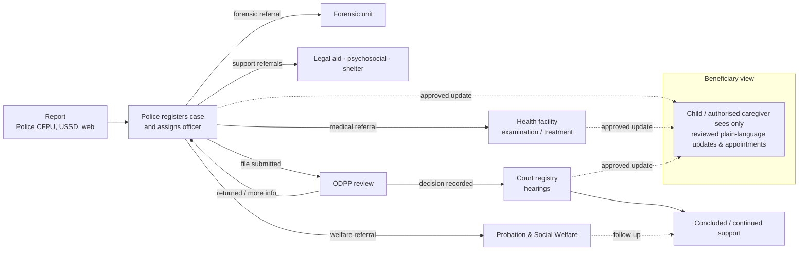
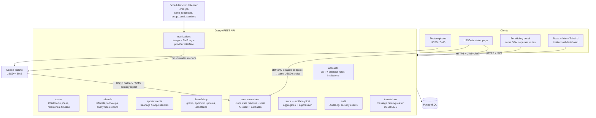
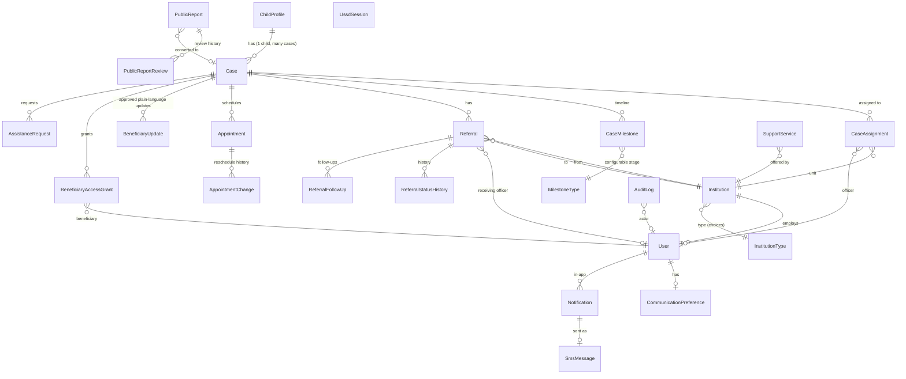

# Tuliwamu — Phase 1: Discovery, Gap Analysis & Architecture

> Status: **proposal for team review**. No implementation code has changed in this phase.
> Scope: the master build prompt ("Child-Sensitive Justice Referral & Case Coordination Platform — Uganda") measured against what is already on `main` (commit `604a38a`).
> Nothing here is legal advice. Every legal reference must be confirmed against the source (see `docs/EVIDENCE.md`) and reviewed by a qualified person before a pilot.

---

## 1. Where we are today (verified 24 Nov 2026)

Checked by running the code, not just reading it:

- `python manage.py test` → **49 tests pass**. `makemigrations --check` → no pending changes.
- Backend: Django 6.1 + DRF + SimpleJWT, apps `accounts`, `cases`, `referrals`, `audit`, `stats`. **SQLite** only.
- Frontend: React 19 + Vite + Tailwind 4, connected to the API with JWT login and a role-aware sidebar.
- USSD callback exists (`referrals/ussd.py`), English only, stateless (parses AT's `text` string).
- SMS: settings exist (`AT_*`, `SMS_ENABLED`) but **no SMS is sent yet** and there is no notifications app.

### What already matches the master prompt (keep it)
| Area | Existing implementation |
|---|---|
| JWT auth, admin-managed staff accounts | `accounts/` (no public sign-up) |
| Institution model + `User.institution` | `accounts.Institution` |
| Need-to-know case access, identity hidden until a referral is accepted | `cases/access.py`, `cases/serializers.py` |
| Audit log of views and changes | `audit.AuditLog`, `/api/cases/<id>/access-log/` |
| Referral state machine, status history, follow-ups | `referrals.Referral`, `ReferralStatusHistory`, `ReferralFollowUp` |
| Anonymous reporting (USSD + web), optional contact, triage → convert to case | `referrals.PublicReport`, `public_views.py` |
| Anonymised statistics with small-cell suppression (`<5`) | `stats/views.py` |
| Fictional seed data | `cases/management/commands/seed_demo.py` |
| Evidence base with sources and verification status | `docs/EVIDENCE.md` |

### Gaps against the master prompt
| # | Master prompt requires | Today | Size |
|---|---|---|---|
| G1 | Medical, Forensic, ODPP, Court roles and institutions | Only Police, PSWO, Legal Aid, Service Provider, Oversight, Admin | M |
| G2 | Configurable case **milestones** (15 suggested stages), separate from referral status | 4 fixed statuses (NEW/UNDER_REVIEW/ACTIVE/CLOSED) | M |
| G3 | Referral statuses Draft/Sent/Acknowledged/In Progress/Completed/Returned for Clarification/Declined/Cancelled; referral to an **institution**; acknowledgement & completion timestamps; priority; purpose-specific shared info | PENDING/ACCEPTED/IN_PROGRESS/COMPLETED/REJECTED; addressed to one officer; free-text institution names | M |
| G4 | Case timeline with **visibility classification** and **reviewed beneficiary-facing explanations** | None | M |
| G5 | Appointments / court hearings + reminders, rescheduling with revised notice | None | M |
| G6 | Beneficiary (child / authorised caregiver) portal with safeguarded, revocable, case-scoped access | Deliberately parked by the team (see §3, D1) | L |
| G7 | Assistance requests from beneficiaries → responsible officer | None | S |
| G8 | In-app notifications + SMS (Africa's Talking) + delivery callbacks + dedup + preferences + quiet hours | Settings only | M |
| G9 | Six languages (EN, SW, LG, Runyankole, Acholi, Ateso) in UI, USSD and SMS | English only, strings hard-coded | M (+ human translation) |
| G10 | USSD: language selection, session state, check status with **PIN**, privacy notice, no phone number stored by default, idempotent callbacks, rate limiting, in-dashboard simulator using the same logic | Partial; "Institution access" authenticates by caller phone number (to be removed) | M |
| G11 | PostgreSQL | SQLite | S |
| G12 | UUIDs in public URLs, no sequential IDs exposed | Integer IDs in `/api/cases/<id>/`, `/api/referrals/<id>/` | M |
| G13 | Pseudonymous child record; one child may have several cases | `Case.child_name` required free text; no child entity | M |
| G14 | Session/logout (refresh-token blacklist), rate limiting on login, security headers, no Basic auth in prod | Basic + Session auth enabled; no login throttle; no blacklist | S |
| G15 | SMS delivery dashboard, audit-log page, accessibility/language settings page, account recovery | None | M |
| G16 | Frontend tests, PWA/offline shell | None | S–M |

---

## 2. The child victim's journey (what the platform coordinates)

The sequence differs by case. The platform records what each institution does; it does **not** decide what happens next.

The beneficiary portal answers five questions: *Has my case been received? Where is it? What has happened? Do I need to attend or do anything? Where can I get help?*

---

## 3. Decisions that change earlier team decisions (need team sign-off)

| ID | Decision | Why | Safeguard |
|---|---|---|---|
| **D1** | **Re-introduce beneficiary access, but only as officer-issued grants.** No public sign-up, no "claim to be a parent" flow. | The master prompt makes the beneficiary portal a core differentiator. The team parked it because self-registration let anyone claim to be a guardian. | A `BeneficiaryAccessGrant` is created by the responsible officer (or PSWO) for **one case**, records the relationship and a safeguarding check ("is this person named in or connected to the allegation?" → must be *No*), has an expiry, can be revoked, and every use is audit-logged. The grant produces a one-time activation code given in person; the beneficiary sets a PIN/password. |
| **D2** | Beneficiaries see **only `BeneficiaryUpdate` records** that an authorised officer has written or approved in plain language. Institutional milestones never flow through automatically. | Required by Module 4; prevents leaking investigative detail. | Separate model and endpoint (`/api/beneficiary/...`), separate serializer, separate permission class. |
| **D3** | Remove USSD "Institution access" (caller phone number = identity). | Phone number is not authentication; prompt forbids treating it as identity. | Institutions use the web dashboard; USSD stays public and anonymous. |
| **D4** | The AI legal assistant stays parked (unchanged). | Prompt forbids automated decisions; sending case text to a third-party LLM is a DPPA risk. | — |
| **D5** | Keep app names where they work (`stats` stays, exposed also as `/api/analytics/`). Add new apps rather than moving models between apps. | Moving models across apps causes migration churn and breaks teammates' branches. | — |

---

## 4. Roles and permissions

Principles: least privilege, need-to-know, institution-level isolation, object-level checks in **every** API view, admin ≠ unrestricted content access.

| Role (code) | Institution type | Cases they can see | Can do | Never sees |
|---|---|---|---|---|
| `POLICE` | `POLICE_CFPU` | Registered by them, assigned to them, or assigned to their unit (`CaseAssignment`) | Register case, assign, record milestones, create referrals, submit to ODPP, approve beneficiary updates, issue access grants | Clinical notes from health, forensic detail |
| `PSWO` | `PROBATION_OFFICE` | Assigned/referred | Welfare referrals, follow-ups, escalate safeguarding concern, approve beneficiary updates, issue access grants | Clinical, forensic, prosecution notes |
| `MEDICAL` *(new)* | `HEALTH_FACILITY` | Minimised view of cases with a referral to **their institution** | Acknowledge, update, complete referral; record "service provided" | Investigation notes, other referrals |
| `FORENSIC` *(new)* | `FORENSIC_UNIT` | Same, for forensic referrals | Acknowledge, update processing, complete | Clinical notes, investigation notes |
| `PROSECUTOR` *(new)* | `ODPP` | Cases submitted to their office | Record review milestones, request more information, record that a decision was made / file returned | Clinical/forensic detail beyond what the referral shared |
| `COURT_REGISTRY` *(new)* | `COURT` | Cases with a court handoff to their registry | Record court milestones, schedule / reschedule hearings (triggers reminders) | Investigation, clinical, forensic |
| `LEGAL_AID`, `SERVICE_PROVIDER` | `LEGAL_AID`, `SERVICE_PROVIDER` (psychosocial, shelter) | Minimised until they acknowledge | Acknowledge, update, complete | As above |
| `OVERSIGHT` | `OVERSIGHT` | None | Anonymised analytics only | Any individual record |
| `ADMIN` | — | **None by default** (change from today) | Users, institutions, service categories, security events, SMS dashboard, aggregate reports | Case content — access requires a "break-glass" action with a reason, audit-logged |
| `BENEFICIARY` *(new)* | — | Only cases in an active, unexpired grant | Read approved updates and upcoming appointments, request assistance, set language/notification preferences | Everything else |

> The current `visible_cases()` gives `ADMIN` every case. D-change: admins lose default content access; tests updated accordingly.

**Information-sharing rule for referrals.** Each referral stores `shared_fields` chosen from a whitelist (e.g. `age_band`, `district`, `incident_category`, `child_alias`, `protection_concerns`, `reason`). The receiver's case view is built only from those fields. "Identity" (`child_alias`/name if held) is revealed only after acknowledgement **and** only if it was in `shared_fields`.

---

## 5. Architecture

Key choices:
- **No Celery/Redis for the MVP.** Reminders run from an idempotent management command (`send_due_reminders`) on a cron schedule; SMS sends are synchronous with a short timeout and recorded as `QUEUED/SENT/FAILED`. Redis is optional later. Rationale: fewer moving parts to deploy on Render's free tier.
- **Provider abstraction.** `notifications.providers.SmsProvider` with `ConsoleProvider` (simulated, clearly labelled `SIMULATED`) and `AfricasTalkingProvider`. Status `SIMULATED` is never shown as "Delivered".
- **Single USSD engine.** `communications/ussd/services.py` exposes `handle(session_id, phone, text, service_code) -> (text, end)`. The AT callback view and the staff simulator both call it.
- **Translations.** Frontend: JSON dictionaries (`src/i18n/{en,sw,lg,nyn,ach,teo}.json`) with English fallback. Backend: Python catalogues for USSD/SMS strings, same keys. Each non-English string carries a review status; unreviewed strings in safeguarding/legal text fall back to English (see R6).

---

## 6. Data model

New/changed models in **bold**. All publicly addressable records get a `public_id` UUID used in URLs; integer PKs stay internal (keeps existing FKs and migrations intact).

| Model | Key fields | Notes |
|---|---|---|
| `Institution` (change) | + types `HEALTH_FACILITY`, `FORENSIC_UNIT`, `ODPP`, `COURT`, `PSYCHOSOCIAL`, `SHELTER`; `region` | Existing rows keep their type |
| `User` (change) | + roles `MEDICAL`, `FORENSIC`, `PROSECUTOR`, `COURT_REGISTRY`, `BENEFICIARY`; `public_id` | |
| **`CommunicationPreference`** | user, language, channel (`IN_APP`/`SMS`/`EMAIL`/`NONE`), `sms_allowed`, quiet hours, `safe_contact_note`, `consent_reference`, `recorded_by` | Required before any SMS to a beneficiary |
| **`ChildProfile`** | `public_id`, `alias` ("Demo Child A"), `age_at_registration` / `birth_year` (optional), `sex` (optional), `preferred_language`; optional `legal_name` (restricted, never in list views/SMS/analytics) | Lets one child have several cases. Existing `Case.child_name` → migrated into `ChildProfile` |
| `Case` (change) | + `public_id`, `child` FK, `reporting_institution`, `reported_at`, `general_location`, `protection_concerns` (choices, multi), `priority`, `lifecycle_status` (OPEN/CLOSED) , `current_milestone` (denormalised) | `description` stays restricted to case-holders |
| **`CaseAssignment`** | case, institution, officer, role_in_case (`LEAD`/`SUPPORT`), active, assigned_by, dates | Institution-level isolation key |
| **`MilestoneType`** | code, label key, applicable institution types, `order`, `is_active`, `default_beneficiary_text_key` | Seeded with the 15 suggested stages; admin-configurable |
| **`CaseMilestone`** | case, type, recorded_by, institution, `visibility` (`INTERNAL`/`INSTITUTIONS_ON_CASE`/`BENEFICIARY_ELIGIBLE`), note (restricted), created_at | The institutional timeline |
| `Referral` (change) | + `public_id`, `from_institution` FK, `to_institution` FK, `category` (MEDICAL, FORENSIC, PROSECUTION, COURT, WELFARE, LEGAL_AID, PSYCHOSOCIAL, SHELTER), `priority`, `shared_fields` (JSON whitelist), `acknowledged_at`, `completed_at`; statuses DRAFT/SENT/ACKNOWLEDGED/IN_PROGRESS/COMPLETED/RETURNED/DECLINED/CANCELLED | Data migration: PENDING→SENT, ACCEPTED→ACKNOWLEDGED, REJECTED→DECLINED; text institution names matched to FKs |
| **`Appointment`** | `public_id`, case, kind (`COURT_HEARING`/`MEDICAL`/`WELFARE_VISIT`/`LEGAL`/`OTHER`), scheduled_for, location (general), institution, status (SCHEDULED/RESCHEDULED/CANCELLED/ATTENDED/MISSED), `beneficiary_visible`, `reminders_sent` | |
| **`AppointmentChange`** | appointment, old/new time, reason (restricted), changed_by | Drives "revised notification" |
| **`BeneficiaryUpdate`** | case, `message_key` or plain text per language, created_by, `approved_by`, `approved_at`, status (DRAFT/APPROVED/WITHDRAWN), linked milestone | Only APPROVED are served to beneficiaries |
| **`BeneficiaryAccessGrant`** | case, beneficiary user, relationship (`SELF`/`PARENT`/`GUARDIAN`/`CAREGIVER`/`SOCIAL_WORKER`), `safeguarding_check_confirmed`, `not_party_to_allegation` (must be true), issued_by, valid_until, revoked_at/by/reason, `activation_code_hash` | Unique (case, beneficiary) while active |
| **`AssistanceRequest`** | case, requested_by (beneficiary), topic (choices), message (short), status (OPEN/ACKNOWLEDGED/RESOLVED), handled_by, response_note, timestamps | Notifies responsible officer |
| **`SupportService`** | institution, category, name, general area, contact (public-facing), languages | Shown in beneficiary & USSD "support services" |
| **`Notification`** | recipient, type, `title_key`, `body_key`, params (non-sensitive only), link (in-app route with public_id), read_at, `dedup_key` (unique) | No case content in params |
| **`SmsMessage`** | recipient phone (stored masked + hashed for dedup), template_key, language, type, status (`SIMULATED`/`QUEUED`/`SENT`/`DELIVERED`/`FAILED`/`REJECTED`), provider, provider_message_id, failure_reason, attempts, created/delivered_at, `dedup_key` | Implements the prompt's `SmsNotification`; body rendered from template, never stored with case data |
| `PublicReport` (change) = prompt's *AnonymousReport* | + `preferred_language`, `verification_status` (UNVERIFIED/…), `review_status`, `urgent_flag`, `pin_hash` (optional), `reviewed_at`; `contact_phone` only if the reporter opted in | Phone number from the USSD session is **not** saved unless opted in (current code already does this) |
| **`PublicReportReview`** | report, reviewer, action, outcome, created_at | Traceable review history |
| **`UssdSession`** | session_id (unique), language, current_menu, data (JSON, short-lived), started_at, expires_at, `last_text`, `completed_report` FK | Purged after expiry by management command; idempotent on repeated callbacks |
| `AuditLog` (change) | `object_id` → `CharField` (holds UUIDs), + `ip_hash`, `reason` (break-glass), new actions (`LOGIN_FAILED`, `ACCESS_DENIED`, `GRANT_ISSUED`, `BREAK_GLASS`) | Security events page reads from here |

Deletion policy: `PROTECT` on anything that would erase history (cases, referrals, institutions); `SET_NULL` on actor FKs; `CASCADE` only for pure children (history rows, follow-ups). Retention: closed cases flagged for review after a configurable period; USSD sessions purged after 10 minutes of expiry.

---

## 7. API contract (target)

Existing paths stay working during the transition; new canonical routes follow the prompt. Detail routes use `public_id`.

| Area | Endpoints |
|---|---|
| Auth | `POST /api/auth/login/` · `POST /api/auth/refresh/` · `POST /api/auth/logout/` (blacklist) · `GET /api/auth/me/` · `POST /api/auth/beneficiary/activate/` |
| Cases | `GET/POST /api/cases/` · `GET/PATCH /api/cases/{id}/` · `GET /api/cases/{id}/timeline/` · `POST /api/cases/{id}/milestones/` · `GET /api/cases/{id}/history/` · `POST /api/cases/{id}/assignments/` · `GET /api/cases/duplicates/?…` |
| Referrals | `GET/POST /api/referrals/` · `GET /api/referrals/{id}/` · `POST /api/referrals/{id}/send/` · `/acknowledge/` · `/start/` · `/complete/` · `/return/` · `/decline/` · `/cancel/` · follow-ups as today |
| Appointments | `GET/POST /api/appointments/` · `PATCH /api/appointments/{id}/` (reschedule → revised notice) |
| Beneficiary updates & grants (staff) | `GET/POST /api/cases/{id}/beneficiary-updates/` · `POST …/{uid}/approve/` · `GET/POST /api/cases/{id}/access-grants/` · `POST …/{uid}/revoke/` |
| Beneficiary portal | `GET /api/beneficiary/cases/` · `GET /api/beneficiary/cases/{id}/updates/` · `GET /api/beneficiary/cases/{id}/appointments/` · `GET /api/beneficiary/support-services/` · `POST /api/beneficiary/assistance-requests/` |
| Assistance (staff) | `GET /api/assistance-requests/` · `PATCH /api/assistance-requests/{id}/` |
| Notifications | `GET /api/notifications/` · `PATCH /api/notifications/{id}/read/` · `GET/PUT /api/notifications/preferences/` |
| Anonymous reports | as today + `POST /api/public-reports/{id}/review/` |
| USSD / SMS | `POST /api/comms/ussd/callback/<secret>/` (AT) · `POST /api/comms/ussd/simulate/` (staff only, same engine) · `POST /api/comms/sms/delivery/<secret>/` (AT delivery reports) · `GET /api/comms/sms/summary/` (ADMIN) |
| Analytics | `GET /api/analytics/overview/` · `/referrals/` · `/case-progress/` (OVERSIGHT, ADMIN) |
| Admin | users, institutions, milestone types, support services, `GET /api/audit/security-events/` |

Response envelope: DRF defaults with a consistent error shape `{"detail": ..., "errors": {...}}`; pagination `?page=` (page size 20).

---

## 8. Security, privacy & safeguarding controls

| Requirement | Control |
|---|---|
| Least privilege / object-level | Per-role queryset scoping in every view + `has_object_permission`; tests that swap IDs in URLs expect **404** |
| Institution isolation | Visibility derived from `CaseAssignment` and referral `to_institution`; no cross-institution listing |
| Admin ≠ content access | Admin case access requires break-glass with reason, audit-logged and shown on the security page |
| Beneficiary safety | Officer-issued, case-scoped, expiring, revocable grants; "not a party to the allegation" confirmation; approved updates only; no names of other parties anywhere in the portal; "Quick exit" button and no persistent notifications on screen |
| JWT | 15-min access, 1-day refresh, rotation + blacklist on logout; tokens kept **in memory + sessionStorage only** (not localStorage); Basic auth disabled outside DEBUG |
| Rate limiting | Login 10/min per IP, public reports 30/h, USSD per-session and per-hashed-MSISDN caps, beneficiary activation 5/h |
| Transport / headers | `SECURE_*` settings, HSTS, `SESSION/CSRF_COOKIE_SECURE` when `DEBUG=False` |
| At rest | Managed PostgreSQL disk encryption; `legal_name` and `contact_phone` field-level encryption (Fernet key from env) — **flag as roadmap if time runs out** |
| Logs | Logging filter strips phone numbers and free text; audit `detail` never contains names/descriptions |
| SMS/USSD | Fixed templates, no child/offence/medical data, quiet hours, opt-in only, delivery reports, dedup key |
| Analytics | Threshold 5 with complementary suppression; no cross-tab of age × location × offence × date; no record IDs |
| Data minimisation | Age band or birth year instead of DOB; alias instead of name by default; general location only |
| Correction | Milestones/updates are append-only; corrections create a new entry referencing the old one ("corrected by") |
| Not allowed | No facial recognition, risk scoring, predictive policing, automated prosecution/guilt decisions, no LLM over case data |

Legal frame to verify (not certified): Children Act Cap 62 (privacy s.148, reporting s.37, PSWO duty s.66), Data Protection and Privacy Act 2019 + Regulations 2021 (s.8 children's data, registration with PDPO). See `docs/EVIDENCE.md`.

---

## 9. Risks & assumptions

| ID | Risk / assumption | Mitigation |
|---|---|---|
| R1 | Re-introducing guardian access can expose a child to an abusive family member | D1 safeguards; grant issued only by officer; revocation; audit |
| R2 | Breaking the referral schema breaks the existing frontend and tests | Data migration + compatibility mapping; update tests in the same PR |
| R3 | Africa's Talking sandbox credentials / short code may not be available at demo time | Console provider + in-app simulator using the same engine; SIMULATED status shown honestly |
| R4 | USSD sessions time out (~180 s) and cost per 20 s | ≤ 6 screens per journey, 160-char screens, numeric choices |
| R5 | Free-text descriptions over USSD may contain identifying details | Prompt warns "do not include names"; reports stored separately and visible only to triage roles |
| R6 | **We cannot produce reliable Luganda, Runyankole, Acholi, Ateso (or reviewed Kiswahili) legal/safeguarding text.** | Ship the translation architecture with English complete; any non-English draft is marked `needs_review` and safeguarding strings fall back to English until a competent speaker approves |
| R7 | PostgreSQL vs. team members running SQLite locally | `DATABASE_URL` env var; SQLite fallback only for local dev, Postgres in CI/tests and deployment |
| R8 | Statistics are from demo data | Label as "what the dashboard measures", never as impact |
| R9 | Scope is large for a hackathon | Priority order in §10; SMS/USSD hardening after core workflows |
| R10 | Legal claims | No claim of legal certification or government approval anywhere in UI or docs |

---

## 10. Roadmap (each step = one PR into `develop`, tests green before the next)

| Phase | Step | Delivers | Prompt priority |
|---|---|---|---|
| 2 Setup | 2.1 | PostgreSQL via `DATABASE_URL`, `dj-database-url`, `psycopg`; security settings; JWT blacklist + `/api/auth/*` aliases; login throttle; `.env.example` updated | 1 |
| 3 Backend | 3.1 | New roles + institution types; `public_id` UUIDs; `ChildProfile`; `CaseAssignment`; admin loses default content access | 1–2 |
| | 3.2 | `MilestoneType` + `CaseMilestone` + timeline/history endpoints; duplicate-case check | 2, 5 |
| | 3.3 | Referral rework (institution-to-institution, new statuses, shared-fields minimisation, action endpoints) + data migration | 3–4 |
| | 3.4 | Appointments + reschedule history | 6 |
| | 3.5 | `notifications`: in-app, `SmsMessage`, provider interface, templates, preferences, dedup, `send_due_reminders` | 6 |
| | 3.6 | `beneficiary`: grants, activation, approved updates, assistance requests, support services | 7 |
| | 3.7 | Analytics endpoints (overview / referrals / case-progress) on top of `stats` | 8 |
| | 3.8 | `communications`: USSD engine (6-language menus, session model, PIN status check, privacy notice), simulator endpoint, AT SMS + delivery callback | 10 |
| | 3.9 | Seed data for every role + full demo story; permission/isolation test suite | all |
| 4 Frontend | 4.1 | Design tokens (palette from the brief), i18n provider + language selector, shared components | 9 |
| | 4.2 | Institutional pages: case registration wizard, case detail with timeline, referral inbox + actions, appointments, notifications, audit/security, SMS dashboard, anonymous reports review, USSD simulator | 1–5 |
| | 4.3 | Beneficiary portal: welcome, my case, timeline, appointments, support, request help, settings, quick exit | 7 |
| | 4.4 | Analytics charts; accessibility pass; PWA shell (no case data cached) | 8 |
| 5 Integration | 5.1 | End-to-end run of workflows A–G; loading/error states | — |
| 6 QA | 6.1 | Security tests (§8), Vitest + Testing Library for key journeys, Playwright smoke test of the judge script | — |
| 7 Deploy | 7.1 | Render (API + Postgres + cron) and Vercel/Netlify (SPA) configs, demo accounts, demo script, README, updated submission | — |

### Demo-account plan (all fictional, password documented in README)
`police.kampala`, `medical.demo`, `forensic.demo`, `prosecutor.demo`, `court.demo`, `pswo.wakiso`, `legalaid`, `support`, `oversight`, `admin`, `beneficiary.demo` (caregiver of "Demo Child A", activated grant).

---

## 11. Open questions for the team
1. Approve D1 (beneficiary access via officer-issued grants) — this reverses the 24 Nov decision to park guardian access.
2. Translations: who can review Kiswahili, Luganda, Runyankole, Acholi and Ateso strings? Until then, non-English safeguarding text falls back to English.
3. Do we have an Africa's Talking sandbox account and (later) a live USSD code? If not, the demo uses the simulator and simulated SMS.
4. Deployment target confirmed as Render + Vercel?
